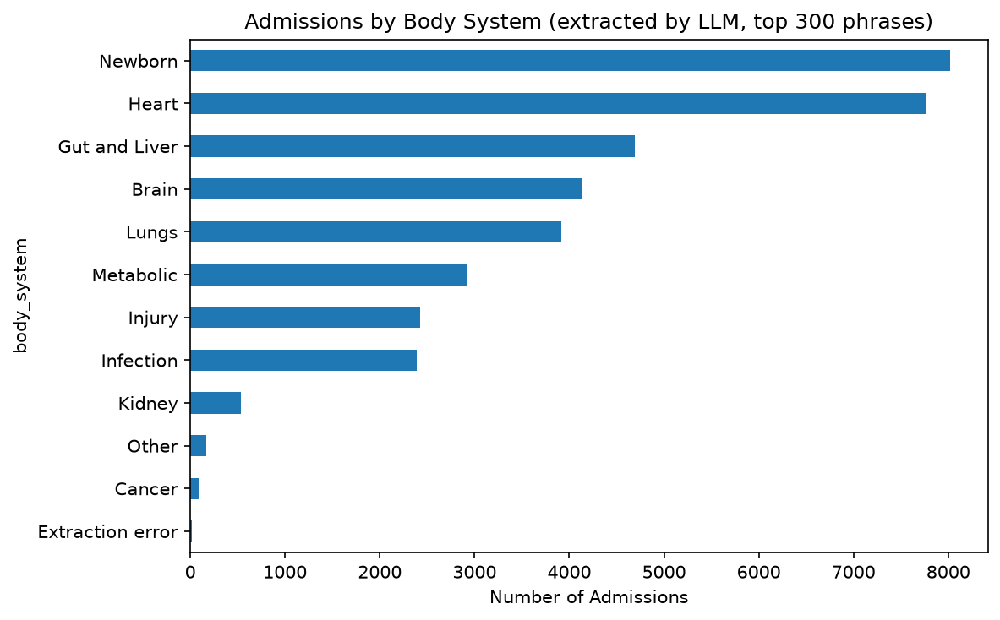

# Clinical Information Extraction from ICU Admission Diagnoses with an LLM

Converting free-text admission diagnoses from MIMIC-III into structured clinical categories with Llama 3.1, then evaluating the output against guideline-based reference labels and a keyword-rule baseline.

**Clinical NLP · LLM Information Extraction · Structured Data Generation · Model Evaluation**


---

## Experimental Results

| Metric | Result |
|---|---|
| Valid structured outputs | **299 / 300 (99.7%)** |
| Agreement with reference labels, `body_system` (n=100) | **86%** (Cohen's κ 0.83) |
| Agreement with reference labels, `procedure_mentioned` (n=100) | **82%** (Cohen's κ 0.56) |
| Admission-weighted agreement | 88.8% body system, 92.5% procedure |
| Admissions labelled | 37,078 of 58,976 (62.9%) from the 300 most frequent phrases |
| Named procedures detected | 14 / 14 (errors were false positives, not misses) |

Agreement metrics are based on 100 AI-assisted reference labels reviewed by the author; they should not be interpreted as independently validated clinical accuracy.

## The Problem

Admission diagnoses in electronic health records are typed as short free text:

```
CORONARY ARTERY DISEASE\CORONARY ARTERY BYPASS GRAFT /SDA
S/P FALL;TELEMETRY
UPPER GI BLEED
```

The field is abbreviated, inconsistent and often holds more than one condition. In MIMIC-III, 58,976 admissions use **15,614 distinct phrases**, and the same condition appears under many spellings (`GI BLEED`, `UPPER GI BLEED`, `GASTROINTESTINAL BLEED`). Inconsistent terminology and abbreviations complicate direct aggregation, cohort analysis and downstream feature engineering, motivating a standardised extraction pipeline.

## What This Project Does

Each phrase is converted into two structured fields:

| Input | `body_system` | `procedure_mentioned` |
|---|---|---|
| `CORONARY ARTERY DISEASE\CORONARY ARTERY BYPASS GRAFT /SDA` | Heart | Yes |
| `UPPER GI BLEED` | Gut and Liver | No |
| `S/P FALL` | Injury | No |

**Approach**
- **LLM:** Llama 3.1 8B served through Ollama; no data is sent to external services
- **Prompting:** few-shot prompt with a closed label set, abbreviation definitions and JSON-only output at temperature 0
- **Validation:** raw responses retained; unparseable or out-of-schema answers recorded as extraction errors instead of being defaulted to "Other"
- **Efficiency:** extraction runs once per unique phrase, with a checkpoint every 50 phrases
- **Evaluation:** 100 randomly sampled phrases compared with reference labels produced with an external LLM from a written annotation guideline (without access to Llama's output) and reviewed by the author; per-category precision, recall and F1, Cohen's kappa, admission-weighted agreement, and a keyword-rule baseline

## Pipeline

```
AdmitDiagnosis (58,976 admissions)
        │
        ▼
Normalise text → 15,614 unique phrases → top 300 (62.9% of admissions)
        │
        ▼
Llama 3.1 8B via Ollama  ──  few-shot prompt, JSON output, temperature 0
        │
        ▼
Schema validation  ──  raw response + status kept for every phrase
        │
        ▼
Map labels back to 37,078 admissions
        │
        ▼
Reference labels (100 phrases)  →  agreement, metrics, baseline, error analysis
```



## Keyword Baseline

| Method | Body system | Procedure |
|---|---|---|
| Llama 3.1 8B | 86% | 82% |
| Keyword rules | 95% | 100% |

The keyword-rule baseline achieved higher agreement on the evaluated sample, particularly for procedure identification. However, because the rules were developed with visibility into the reference examples, these results are exploratory rather than an independent generalisation benchmark.

The comparison suggests that deterministic rules may be preferable for narrowly defined procedure indicators, while LLM-based extraction remains worth investigating for more variable clinical terminology: the rules misfire on surface wording (`STAB` inside `UNSTABLE ANGINA` → Injury, `CEREBRAL VASCULAR ACCIDENT` → Injury) and match no keyword for 33.7% of the 15,314 less frequent phrases. Further evaluation on a held-out dataset is required to establish comparative performance.

## Error Analysis

Of the 32 observed disagreements, 26 were concentrated in five recurring patterns, suggesting opportunities to improve prompt instructions, label definitions and clinical terminology handling:

| Pattern | Disagreements | Example |
|---|---|---|
| `/SDA` with no named procedure not marked Unclear | 11 | `LIVER MASS/SDA` → No |
| Telemetry treated as a procedure | 6 | `PNEUMONIA;TELEMETRY` → Yes |
| Cancer assigned to the organ | 3 | `LUNG CANCER/SDA` → Lungs |
| Blood-vessel conditions misplaced | 3 | `CAROTID STENOSIS` → Injury |
| Altered mental status → Metabolic | 3 | `MENTAL STATUS CHANGES` |

## Repository Structure

```
├── admit_diagnosis_llm_extraction.ipynb   ← full pipeline, results and findings
├── images/
│   └── body_system_distribution.png
├── requirements.txt
├── .gitignore
└── README.md
```

Data files and outputs containing patient-level rows are excluded under the MIMIC data use agreement.

## Reproducibility

- **Input:** `admit_diagnosis.csv` with the columns `hadm_id` and `AdmitDiagnosis`
- **Model:** inference requires Ollama with `llama3.1:8b`; prompts run at temperature 0 with JSON output
- **Checkpointing:** extraction results are saved to `outputs/llm_labels.csv`; when present, the 50-minute extraction step is skipped
- **Evaluation:** requires the reference-label workbook `outputs/reference_labels.xlsx`, which is not reproduced by installing the dependencies
- **Sampling:** fixed random seeds (`random_state=7` for the evaluation sample, `42` for the pilot run)

## How to Run

1. **Install Ollama** from [ollama.com](https://ollama.com) and download the model:
   ```
   ollama pull llama3.1:8b
   ```
2. **Install Python packages** (tested with Python 3.12):
   ```
   pip install -r requirements.txt
   ```
3. **Get the data:** download `mimic3c.csv` from [Kaggle](https://www.kaggle.com/datasets/drscarlat/mimic3c) and save the `hadm_id` and `AdmitDiagnosis` columns as `admit_diagnosis.csv` in the project folder.
4. **Run the notebook** with Ollama running:
   ```
   python -m notebook
   ```

The full extraction of 300 phrases takes about 50 minutes on CPU; with saved results the notebook runs in a few minutes.

## Lessons Learned

- **Valid output is not correct output:** 99.7% of responses were well-formed, but agreement was 82–86%, so evaluation against a reference is essential.
- **Most errors traced back to task definition:** missing rules in the prompt and gaps in the label set explained most disagreements.
- **The simplest adequate tool wins:** for a narrow, keyword-like field, deterministic rules matched the reference better than the LLM.

## Limitations

- Only the 300 most frequent phrases were processed.
- Reference labels come from an LLM following a written guideline, reviewed by a non-clinician; agreement measures consistency with that guideline, not clinical accuracy.
- The 100-phrase sample is small, so per-category metrics are imprecise for rare categories.
- Admission diagnoses are short; full clinical notes contain far more information.

## Future Work

- Revised prompt adding the telemetry, `/SDA`, cancer and vascular rules, evaluated on the same reference set
- Clinician review of the reference sample
- Extraction on all 15,614 phrases, using keyword rules for `procedure_mentioned` and the LLM for `body_system`
- Application to full clinical notes (MIMIC-III NOTEEVENTS)

## Tech Stack

| Layer | Tools |
|---|---|
| LLM | Llama 3.1 8B, Ollama |
| Data | pandas, NumPy |
| Evaluation | scikit-learn, openpyxl |
| Visualisation | matplotlib |

---

**Data:** MIMIC-III Clinical Database (Johnson et al., 2016), aggregated version from Kaggle.
**Author:** Krishna K. Joshi · [GitHub](https://github.com/KrishnaKJoshi1)
